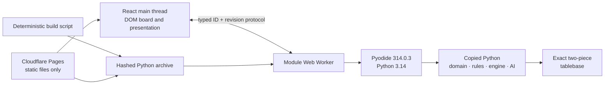

# GPT Jungle — Web Edition

Play Jungle / Dou Shou Qi against the original Python AI in a browser. The verified production game is live at **[gpt-jungle.pages.dev](https://gpt-jungle.pages.dev)** on Cloudflare Pages. Deployment status and the dated public checklist are recorded in [release validation](docs/release-validation.md).

This is a real browser port of [GPT_CX_Jungle](https://github.com/xmiao76/gpt_cx_jungle), not a JavaScript rewrite of its rules. The copied Python domain, rules, engine, all three AI profiles, and exact two-piece tablebase run locally in Pyodide 314.0.3 inside a module Web Worker. Cloudflare serves static files only.

## Visual overview

The responsive game screen places a 7×9 illustrated board beside turn status, controls, AI search diagnostics, and move history. On narrow screens the panel moves below the complete board. Every square is a keyboard-operable button; pieces retain readable English labels in both board orientations. The UI includes selection and capture markers, last-move feedback, animation, result and rules dialogs, synthesized audio, reduced-motion support, and staged runtime loading.

## Play

Blue always moves first. Choose **Human starts** to control Blue or **AI starts** to control Red, independently of board orientation. Select an animal and then a highlighted legal destination.

Win by entering the opponent's den, capturing every opposing animal, or leaving the opponent without a legal move. This engine intentionally has no gameplay repetition or no-capture draw. The complete engine-specific rules—including Rat/Elephant, river, jump, trap, and den behavior—are available from **How to Play** and the [authoritative source ruleset](https://github.com/xmiao76/gpt_cx_jungle/blob/b0bb427458a686aa0ed10770bda50f9311a7845b/docs/ruleset.md).

- **Easy / Medium / Hard** retain the desktop search profiles with 250 / 750 / 1,800 ms browser budgets. Hard uses compact alpha-beta search and the exact two-piece tablebase.
- **Undo** normally removes a completed human/AI pair; **Redo** restores those exact plies without asking the AI to search again.
- **Save / Load** downloads and reads portable JSON files. **Flip Board** changes display mapping only.
- **Diagnostics** exposes authoritative targets, effective rank, runtime data, and search statistics. **AI vs AI** yields after each move and stops after an in-progress search completes.
- **Mute** controls local Web Audio cues. No account, telemetry, or remote game storage is used.

## Local development

Prerequisites are Node.js 22 (the repository pins `22.16.0`) and Python 3.12 or newer. Pyodide is fetched from the official jsDelivr distribution on first browser load.

```powershell
git clone https://github.com/xmiao76/gpt_jungle_web.git
cd gpt_jungle_web
npm ci
python -m pip install "pytest>=9.0.3"
npx playwright install chromium firefox webkit
npm run dev
```

Commands:

```powershell
npm run dev             # build the Python payload and start Vite
npm run build:python    # verify source hashes and make the deterministic archive
npm run build           # Python archive, TypeScript check, production Vite bundle
npm run preview         # serve dist locally
npm run lint            # ESLint with zero warnings
npm test                # Vitest and React Testing Library
npm run test:python     # copied engine and browser-adapter tests under CPython
npm run test:e2e        # real Worker/Pyodide tests in Chromium, Firefox, and WebKit
npm run test:public     # hook-free smoke and complete-game checks against production
npm run test:all        # source audit, all tests, lint, and production builds
npm run deploy          # deploy an already validated dist to Cloudflare Pages
```

For a manual release:

```powershell
npm run test:all
npm run build
npx wrangler pages deploy dist --project-name gpt-jungle --branch main
```

The live `gpt-jungle` project uses authenticated Cloudflare Pages Direct Upload through `npm run deploy`; repository CI validates every pushed source revision but does not hold deployment credentials. The account's Wrangler OAuth login could create/deploy the project, while the public source-enabled API required a separate API-token credential that was not present. [Cloudflare makes a project's Direct Upload versus Git-integration mode immutable](https://developers.cloudflare.com/pages/get-started/direct-upload/), so changing this existing project to automatic Git deployment would require creating a differently named Pages project. Build settings remain `npm run build`, output `dist`, and Node 22.

There are no Pages Functions, Worker handlers, bindings, secrets, databases, KV namespaces, Durable Objects, or R2 buckets. The Pages project name is derived from `gpt_jungle_web` by removing the generic `_web` suffix and converting underscores to hyphens: `gpt-jungle`.

## Architecture



The main thread owns presentation state only: selection, dialogs, animation, sound, orientation, and AI-vs-AI scheduling. The Worker owns one authoritative Python session. Runtime-validated messages carry request IDs and revisions, and stale state responses are rejected. Canonical indices are always Red-at-top/Blue-at-bottom; flipped display index `v` maps to canonical index `62 - v`, without mutating game state.

During `npm run build`, `scripts/build-python-archive.mjs` verifies every reusable Python/tablebase file against `python/source-manifest.json`, then creates a byte-reproducible, content-hashed zip. This preserves the package layout needed by `importlib.resources` to find the tablebase. See [architecture](docs/architecture.md) for the protocol and release boundaries.

## Saves and compatibility

Save files use schema `gpt-jungle-save`, version `1`, and include engine version `0.1.0`, timestamp, serializable `GameState`, difficulty, human side, and orientation. Import validates the wrapper in TypeScript and the board, enums, move history, turn, terrain occupancy, and terminal state in Python before replacing the live session. A loaded game intentionally begins with empty undo/redo stacks, matching the desktop format limitation.

## Browser support and limitations

The production bundle is exercised with current Playwright Chromium, Firefox, and WebKit desktop engines. The layout supports touch-sized controls and narrow mobile viewports. Current limitations:

- The first visit requires network access for the pinned Pyodide runtime and may take several seconds; there is no service worker or offline mode.
- AI search is synchronous inside its Worker. The page stays responsive, but AI-vs-AI Stop and other state changes take effect after the current search.
- Save files do not preserve undo/redo stacks.
- Synthesized sound starts only after a browser-accepted user gesture and fails silently where Web Audio is unavailable.

## Provenance

| Component | Model | Reasoning effort | Code agent | Version / commit |
| --- | --- | --- | --- | --- |
| Source desktop engine | GPT 5.6-Sol | Ultra | Codex | Engine 0.1.0 · [`b0bb427`](https://github.com/xmiao76/gpt_cx_jungle/commit/b0bb427458a686aa0ed10770bda50f9311a7845b) |
| Web port | GPT-5 | Not exposed by the implementation runtime | Codex | Frontend 1.0.0 |

Runtime details are also visible in the application: Pyodide `314.0.3`, detected Python `3.14.x`, and engine `0.1.0`. Source provenance and SHA-256 hashes are locked in [`python/source-manifest.json`](python/source-manifest.json).

## Verification

The copied CPython suite, source manifest, unit/component suite, production build, cross-browser real-Pyodide flows, exact tablebase probe, and deterministic authentic terminal game are automated. Performance measurements and the dated deployment checklist live in [release validation](docs/release-validation.md). CI runs the entire suite on every pull request and `main` push.
