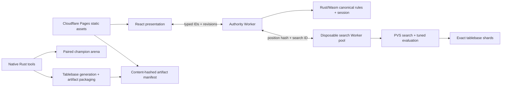

# GPT Jungle — Rust/Wasm edition

Play Jungle / Dou Shou Qi against a local, strength-oriented engine in the
browser. React owns presentation; one authoritative Rust rules engine and a
two-second PVS search run in WebAssembly Workers. The site remains private and
static: there is no account, telemetry, remote game service, or server-side AI.

The public site is [gpt-jungle.pages.dev](https://gpt-jungle.pages.dev). A
deployment can lag the repository until the release gate and Direct Upload are
run.

## Play

Blue moves first. Choose **Human starts** to play Blue or **AI starts** to play
Red. Select an animal, then one of its highlighted legal destinations.

Win by entering the opposing den, capturing every opposing animal, or leaving
the opponent without a legal move. This project intentionally preserves its
original variant:

- Dog is rank 3 and Wolf rank 4.
- Lion can jump either river span; Tiger can jump only the two-square span.
- Rats, Elephants, water, traps, and dens retain the original engine behavior.
- Repetition and no-capture sequences are not adjudicated as gameplay draws.

The UI retains Easy, Medium, and Hard profiles at 250 ms, 750 ms, and 2,000 ms.
Hard uses the strongest available Wasm path; capability detection selects a
scalar single-thread fallback when SIMD, threads, or cross-origin isolation are
unavailable.

Undo/redo, portable JSON saves, AI-vs-AI, board flipping, keyboard play,
responsive layout, audio, reduced motion, diagnostics, and version-1 save
imports remain supported.

## Architecture



The same Rust move generator, state transitions, terminal evaluation, hashing,
and serialization are used by browser play, search, tablebase tooling, and the
native referee. Search results carry their base revision and position hash; the
authority rejects stale results and revalidates every move before mutation.

Optional exact tablebase artifacts are integrity checked and cached in a 250 MiB
IndexedDB LRU. Fetching never extends the move clock. Cloudflare Pages serves
content-hashed shards as static files and applies COOP/COEP headers for the
shared-memory fast path.

See [engine v2](docs/engine-v2.md) and [architecture](docs/architecture.md).

## Local development

Prerequisites:

- Node.js 22.16 or newer (`.node-version` is authoritative)
- Rust 1.94.1 with `wasm32-unknown-unknown` (`rust-toolchain.toml` is authoritative)
- wasm-pack 0.15.0
- Python 3.12+ and pytest only for the frozen v1 referee/regression suite
- Playwright browsers for end-to-end validation

```powershell
npm ci
python -m pip install "pytest>=9.0.3"
npx playwright install chromium firefox webkit
npm run dev
```

Important commands:

```powershell
npm run build:engine     # deterministic Rust/Wasm engine + artifact manifest
npm run test:rust        # Rust workspace tests
npm run test:python      # frozen reference/referee regressions
npm test                 # TypeScript, protocol, and React tests
npm run test:e2e         # real browser Worker/Wasm flows
npm run benchmark:ai     # equal-time paired smoke and strength diagnostics
npm run test:all         # complete release gate
npm run build            # production static bundle
npm run deploy           # validated Cloudflare Pages Direct Upload
```

Native workspace commands can be run directly:

```powershell
cargo test --manifest-path engine/Cargo.toml --workspace
cargo run --manifest-path engine/Cargo.toml -p jungle-cli -- serve
python -m tools.legacy_engine_jsonl
```

## Saves and compatibility

Saves retain schema `gpt-jungle-save`, version `1`, canonical board indices,
difficulty, human side, orientation, and validated game state. Engine v2 rejects
out-of-range coordinates, contradictory outcomes, duplicate animals, illegal
histories, and moves after the first terminal result. Valid historyless puzzle
positions remain importable. Undo/redo and search caches are intentionally not
serialized.

## Strength and release policy

The old `web-hard-v2` engine at the same 2,000 ms budget is the first frozen
champion. A candidate is promoted only through paired holdout games with colors
reversed, no illegal moves/crashes/deadline losses, at least 45% from each color,
and the lower endpoint of a paired two-sided 95% interval above 50%. Inconclusive candidates
are not promoted. Threaded/SIMD and broad fallback builds have separate ladders.

Perft, rule matrices, make/unmake/hash checks,
tablebase audits, fixed-node search tests, save migrations, cross-browser flows,
and UI responsiveness remain hard correctness gates. Nodes per second and
nominal depth are diagnostics, not strength claims.

## Hosting

The application remains a Cloudflare Pages Direct Upload project with no Pages
Functions, Workers, bindings, secrets, databases, KV, Durable Objects, or R2.
Build output is `dist`; generated engine artifacts are created under
`public/generated` and are not committed. Releases continue to use the existing
`gpt-jungle` project and can roll back to a previous immutable Pages deployment.

## Provenance

Production engine v2 is authored in this repository and identified by its Rust
crate version, engine ABI, rules fingerprint, evaluator ID, and content hashes.
The manifest-locked Python engine remains test-only as the frozen referee and
initial champion; it is not included in the production browser payload.
